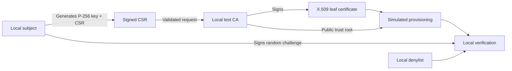

# Architecture

## Modules

- `src/x509_provisioning_lab/core.py`: cryptographic primitives, file storage, root issuance, CSR validation, leaf issuance, proof-of-possession, local denylist and demo.
- `src/x509_provisioning_lab/cli.py`: JSON CLI result envelope, hidden prompts, anchored output paths, input handling and exit codes.
- `run_x509lab.py`: no-install launcher for the extracted source tree.
- `run_tests.py`: regression test launcher.
- `scripts/package_source.py`: allowlisted source release builder; never includes generated credentials.

## Stored output

A root named `example` lives under `artifacts/example` regardless of the caller's working directory. Generated CA and subject private keys are encrypted PEM (PKCS#8); CSR, issued certificates and installed copies are public. The tool refuses overwrite of existing key/certificate files and rejects symlinked output paths. It does not implement a protected operating-system storage boundary.

### States

1. **New root:** `init-ca` creates encrypted CA key, self-signed CA certificate and pinned profile metadata.
2. **CSR:** `new-identity` generates a unique subject key and CSR containing a test URI SAN.
3. **Issued:** `issue` validates the CSR, its identity and its signature, then signs the leaf.
4. **Installed:** `provision` verifies the leaf, checks key possession and writes public credentials plus a non-secret receipt.
5. **Verified:** `verify` re-checks the installed chain and signs a fresh challenge to confirm private-key possession.
6. **Locally denied:** `revoke` adds a fingerprint to the simulator's local denylist. Subsequent `verify` calls reject it.

The test profile generates `clientAuth` and `serverAuth` EKUs, with no DNS SAN; it does **not** claim that the certificate is accepted by a browser or any other specific protocol implementation.
